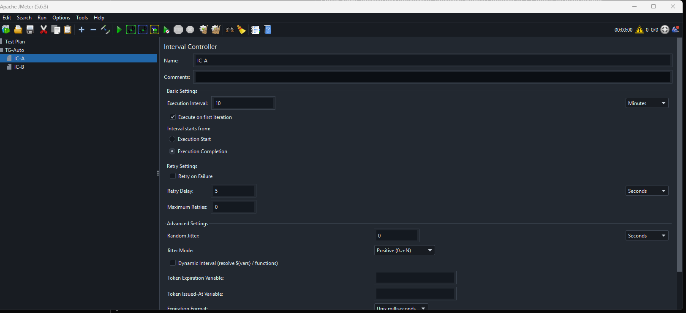
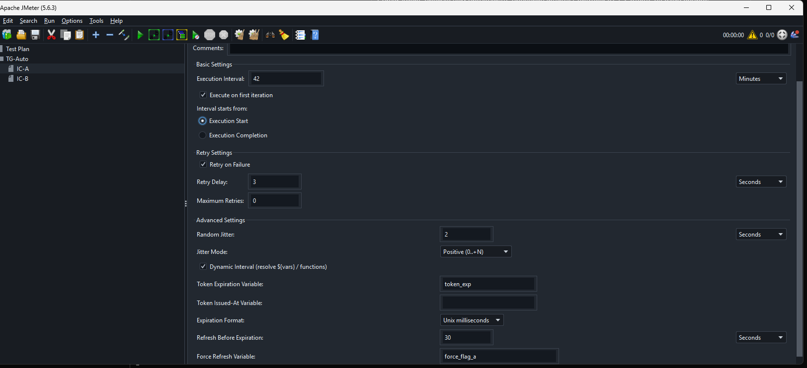
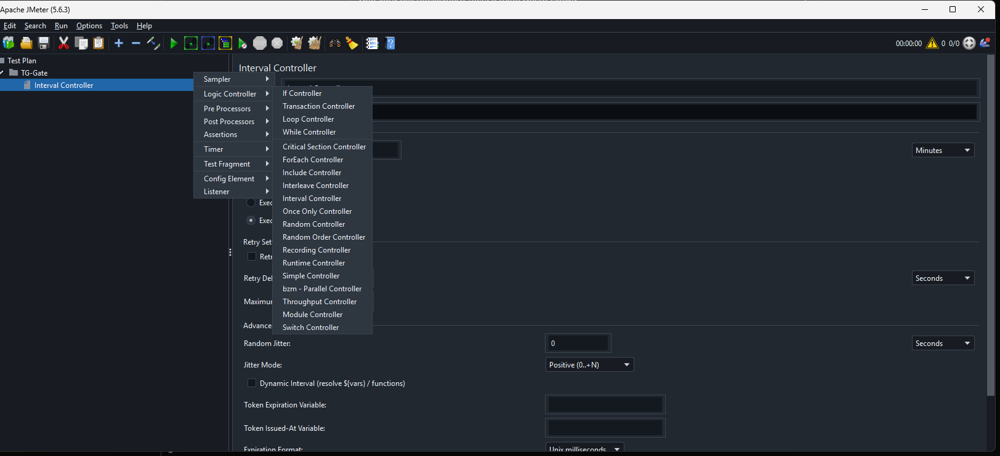

# Interval Controller for Apache JMeter

**Version 1.1.2** · Target: **Apache JMeter 5.6.3** · Minimum Java: **8**

Interval Controller is a Logic Controller that runs its nested elements at most once per configured interval **per JMeter thread**, and only when that thread encounters the controller. When the interval has not elapsed, nested samplers are **skipped immediately** — the thread is not blocked, and siblings outside the controller continue normally.

This is **not** a JMeter Timer and does **not** wake up on a background schedule.

Repository: https://github.com/GeorgeKalyaev/jmeter-interval-controller

---

## Overview

Typical uses:

- Refresh authentication or tokens on a fixed cadence while continuous API traffic continues.
- Run expensive setup samplers infrequently without sleeping the whole Thread Group.
- Combine interval windows with optional retry, jitter, dynamic expressions, and token TTL helpers.

## Features

Verified capabilities in v1.1.2:

| Area | Capability |
|------|------------|
| Scheduling | Interval-based EXECUTE / SKIP |
| First pass | Execute on first iteration (optional) |
| Anchoring | Interval measured from Execution Start or Execution Completion |
| Retry | Retry on Failure, Retry Delay, Maximum Retries |
| Timing variance | Random Jitter, Jitter Mode |
| Expressions | Dynamic Interval (`${vars}` / functions) |
| Tokens | Token Expiration Variable, Issued-At Variable, Expiration Format, Refresh Before Expiration, Force Refresh |
| UX / persistence | GUI configuration, JMX persistence |
| Nesting | Compatible nested controller behavior (Once Only / Loop) |

## Important behavior

1. The controller **does not** independently wake up on a timer.
2. Scheduling is evaluated **when JMeter encounters** the controller in the thread path.
3. If the interval has not elapsed, nested elements are **skipped** (no sleep, no Thread Group block).
4. Samplers **outside** the controller continue on every iteration.
5. State is **per applicable JMeter thread** (each thread clone keeps its own anchors / retry / TTL binding).
6. Interval Controller is **not** equivalent to a standard JMeter Timer.

## Installation

Canonical artifact:

- File: `jmeter-interval-controller-1.1.2.jar`
- SHA-256: `94F834F68B6825240C6179D15352BF693583B444B1C3F7D441CD190E5EDF591C`

Steps:

1. Copy the JAR into `apache-jmeter-5.6.3/lib/ext/`.
2. Remove any older `jmeter-interval-controller-*.jar` (1.0.0 / 1.1.0 / 1.1.1). Multiple versions cause undefined behavior.
3. Restart JMeter.
4. Verify: **Add → Logic Controller → Interval Controller**.

No additional dependency JARs need to be copied manually. Runtime libraries are provided by JMeter (`provided` Maven scope).

### Uninstall

Delete `jmeter-interval-controller-1.1.2.jar` from `lib/ext` and restart JMeter.

## Quick start

1. Add a Thread Group.
2. Add **Interval Controller** under the Thread Group.
3. Set **Execution Interval** = `10`, unit **Minutes**.
4. Keep **Execute on first iteration** enabled.
5. Keep **Interval starts from** = **Execution Completion**.
6. Place authentication (or other infrequent work) **inside** the controller.
7. Place regular API samplers as **siblings** after the controller.

See [Run Authentication Once Every 10 Minutes](docs/EXAMPLES.md#run-authentication-once-every-10-minutes) and `examples/02-authentication-refresh.jmx`.

## Examples

Importable JMX plans (self-contained demos; no real credentials):

| File | Purpose |
|------|---------|
| [`examples/01-basic-interval-10-minutes.jmx`](examples/01-basic-interval-10-minutes.jmx) | Basic 10-minute interval (shortened for demo) |
| [`examples/02-authentication-refresh.jmx`](examples/02-authentication-refresh.jmx) | Auth once per interval; APIs every iteration |
| [`examples/03-retry-on-failure.jmx`](examples/03-retry-on-failure.jmx) | Retry on Failure demonstration |
| [`examples/04-jitter-and-dynamic-interval.jmx`](examples/04-jitter-and-dynamic-interval.jmx) | Jitter + dynamic interval |
| [`examples/05-token-expiration-and-force-refresh.jmx`](examples/05-token-expiration-and-force-refresh.jmx) | TTL / force refresh demonstration |

## Screenshots

| | |
|--|--|
|  | Interval Controller in the test plan tree (10 Minutes, Execution Completion) |
|  | Interval Controller GUI with detailed settings |
|  | Add → Logic Controller → Interval Controller |

## Compatibility

| Environment | Status |
|-------------|--------|
| Apache JMeter 5.6.3 | Verified |
| Java 8 (bytecode major 52) | Verified |
| Java 17 running JMeter / tests | Verified |
| Windows GUI | Verified |
| Windows Non-GUI | Verified |
| Linux Non-GUI (Docker) | Verified |
| Linux GUI | Not tested |
| Other JMeter versions | Not tested |

## Configuration reference

Full GUI field documentation: [docs/CONFIGURATION.md](docs/CONFIGURATION.md)

Also:

- [docs/QUICK_START.md](docs/QUICK_START.md)
- [docs/EXAMPLES.md](docs/EXAMPLES.md)
- [docs/TROUBLESHOOTING.md](docs/TROUBLESHOOTING.md)
- [docs/ARCHITECTURE.md](docs/ARCHITECTURE.md)
- [docs/RELEASE_VERIFICATION.md](docs/RELEASE_VERIFICATION.md)

## Build

Requirements: JDK 8+ (release target 8), Maven 3.6+.

```bash
mvn -B -s .mvn-settings.xml clean verify
```

Fresh builds are for development. The **canonical** public release JAR is the verified artifact with the SHA-256 above; do not substitute a local rebuild when distributing v1.1.2.

## Support

Report defects via GitHub Issues:

https://github.com/GeorgeKalyaev/jmeter-interval-controller/issues

Security disclosures: see [SECURITY.md](SECURITY.md).

## License

Copyright 2026 Georgii Kaliaev. Licensed under the Apache License, Version 2.0. See [LICENSE](LICENSE).

## Disclaimer

This project is an independent community plugin. It is **not** affiliated with or endorsed by the Apache Software Foundation.
